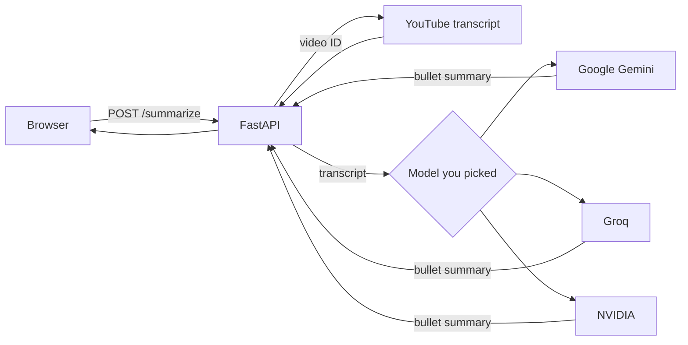

# YouTube video summarizer

Paste a YouTube link, pick an AI model and get the video's key points in a few seconds. A FastAPI backend pulls the transcript with `youtube-transcript-api` and sends it to the model you chose: Google Gemini, Groq or NVIDIA, all on their free tiers. Every push to `main` deploys to a Google Cloud VM through GitHub Actions.



## Choose your model

The page has two dropdowns, one for the provider and one for the model. All three providers accept the OpenAI chat-completions format, so `utils/llm_providers.py` uses a single OpenAI client and only swaps the base URL, the API key and the model name.

| Provider | Models | API key |
|---|---|---|
| Google Gemini | Gemini 2.5 Flash, Gemini 2.5 Flash-Lite | `GEMINI_API_KEY` from Google AI Studio |
| Groq | GPT-OSS 20B, GPT-OSS 120B, Qwen3.8 27B | `GROQ_API_KEY` from console.groq.com |
| NVIDIA | DeepSeek V4.1 Flash, Nemotron 3.5 Lightning 30B, Nemotron 3 Ultra 550B | `NVIDIA_API_KEY` from build.nvidia.com |

A provider becomes selectable as soon as its key is set, and you need at least one. To add a model, add a line to its provider in `utils/llm_providers.py`. The backend only accepts the models listed there, so your keys can't be used for anything else.

Free tiers have limits:

- Groq's free plan allows about 8,000 tokens a minute, so for long videos it summarizes the first part of the transcript, and the page says so.
- When a model reaches its free limit, the page asks you to pick another one.
- On Gemini's free tier, Google may use prompts to improve its products, and NVIDIA's free endpoints are meant for prototyping.

## API

| Method | Endpoint | What it does |
|---|---|---|
| GET | `/` | Serves the web page |
| GET | `/api/models` | Lists the providers and models, which ones have a key, and the default choice |
| POST | `/summarize` | Body `{"video_id": "...", "provider": "groq", "model": "openai/gpt-oss-20b"}`. `provider` and `model` are optional and fall back to the default. Returns the summary, or `{"error"}` with a matching HTTP status |

## Run locally

You need Python 3.10 or newer and at least one API key.

```bash
python -m venv venv
source venv/bin/activate        # Windows: venv\Scripts\activate
pip install -r requirements.txt
```

Create a `.env` file with the keys you have:

```
GEMINI_API_KEY=<your Gemini key>
GROQ_API_KEY=<your Groq key>
NVIDIA_API_KEY=<your NVIDIA key>
```

Then start the server:

```bash
uvicorn main:app --reload
```

Open http://localhost:8000, pick a model and paste a YouTube link.

## Deployment

`.github/workflows/deploy.yml` runs on every push to `main`. It connects to the VM over SSH, resets the app folder to the latest `main`, installs the requirements and starts Uvicorn on port 8000. It needs these repository secrets: `SSH_PRIVATE_KEY`, `GCP_VM_IP` and `GCP_VM_USER`, plus the API keys you use: `GEMINI_API_KEY`, `GROQ_API_KEY` and `NVIDIA_API_KEY`.

## Project structure

```
main.py                       FastAPI app and routes
utils/llm_providers.py        Providers, models and the summary request
utils/transcript_generate.py  Fetches the transcript
templates/index.html          Web page with the provider and model pickers
.github/workflows/deploy.yml  Deploys to the GCP VM
```
