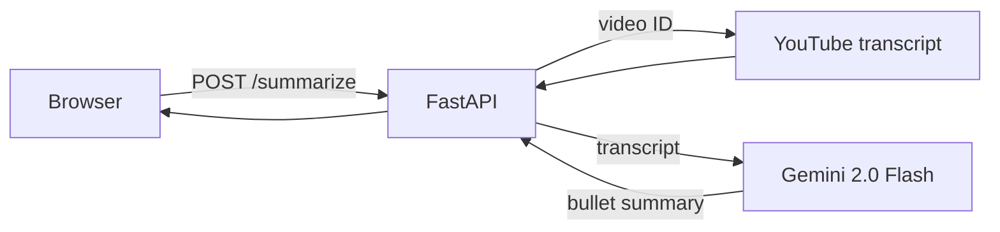

# YouTube video summarizer

Paste a YouTube link and get the video's key points in a few seconds. A FastAPI backend pulls the transcript with `youtube-transcript-api` and asks Google Gemini (`gemini-2.0-flash`) for a short, scannable summary, and a simple page served by FastAPI shows the result. Every push to `main` deploys to a Google Cloud VM through GitHub Actions.



## API

| Method | Endpoint | What it does |
|---|---|---|
| GET | `/` | Serves the web page |
| POST | `/summarize` | Body `{"video_id": "..."}`. Returns `{"video_id", "summarize_transcript"}`, or `{"error"}` when the transcript isn't available |

## Run locally

You need Python 3.10 or newer and a Gemini API key.

```bash
python -m venv venv
source venv/bin/activate        # Windows: venv\Scripts\activate
pip install -r requirements.txt
echo GEMINI_API_KEY=<your key> > .env
uvicorn main:app --reload
```

Open http://localhost:8000 and paste a YouTube link.

## Deployment

`.github/workflows/deploy.yml` runs on every push to `main`. It connects to the VM over SSH, resets the app folder to the latest `main`, installs the requirements and starts Uvicorn on port 8000. It needs these repository secrets: `SSH_PRIVATE_KEY`, `GCP_VM_IP`, `GCP_VM_USER` and `GEMINI_API_KEY`.

## Project structure

```
main.py                       FastAPI app and routes
utils/transcript_generate.py  Fetches the transcript
utils/gemini_summarizer.py    Summarizes it with Gemini
templates/index.html          Web page
.github/workflows/deploy.yml  Deploys to the GCP VM
```
